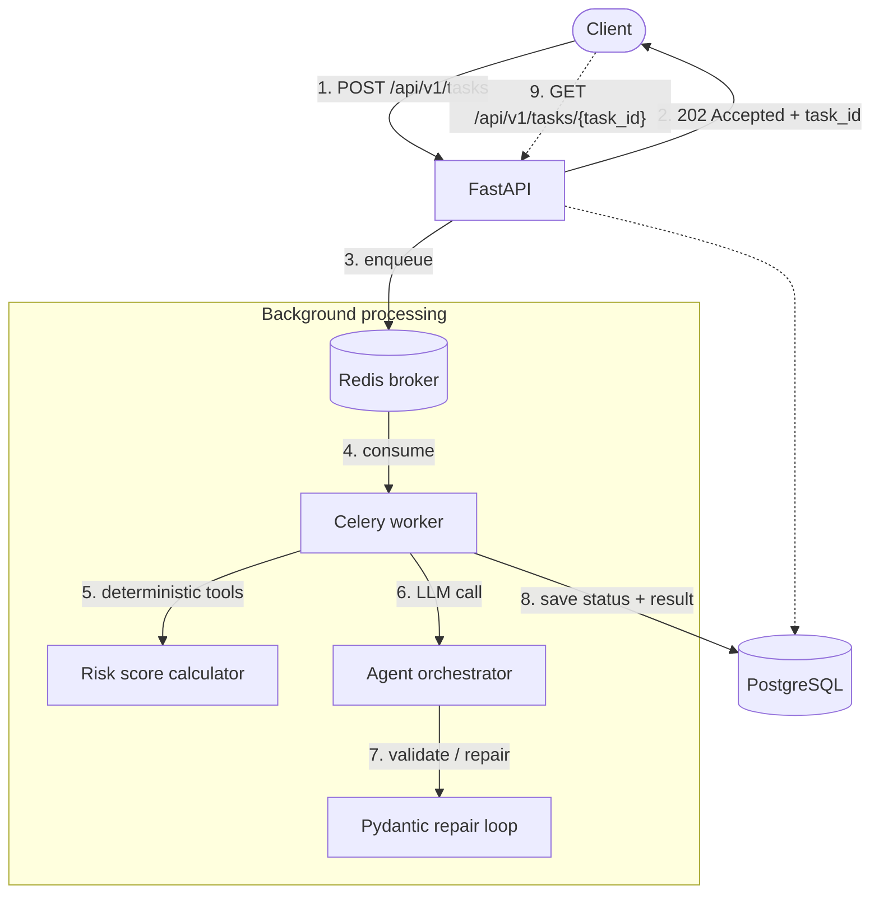

# ⚡ AgentPulse API

> **Asynchronous AI agent orchestration with validated LLM output**

[](https://www.python.org/)
[](https://fastapi.tiangolo.com/)
[](https://docs.celeryq.dev/)
[](https://redis.io/)
[](https://www.postgresql.org/)
[](https://www.docker.com/)

AgentPulse is a backend for running **long AI agent tasks** without HTTP timeouts. A request returns immediately with `202 Accepted` and a `task_id`; the work runs in a **Celery + Redis** worker; the result is stored in **PostgreSQL** and fetched later by ID.

Its core feature is a **Pydantic repair loop**: when the LLM returns malformed or incomplete JSON, the validation error is sent back to the model so it can fix its own output — up to a fixed number of attempts. Numbers are computed by **deterministic Python tools**, not by the LLM — and any answer in which the LLM changed them is rejected and repaired like a schema error.

It runs with a real LLM (Groq or OpenAI, one environment variable) or, without a key, with a built-in stub.

It is also the execution layer of [FinAgent](https://github.com/alainy-rocha-dev/FinAgent).

---

## Architecture



## The repair loop in action

The LLM must return JSON matching this schema:

```python
class AnalysisOutputSchema(BaseModel):
    summary: str
    key_findings: list[str]
    metrics: MetricsSchema      # total_score, risk_level, calculated_items
    metadata: MetadataSchema    # repair_attempts, execution_time_seconds, model_used
```

**Attempt 1** — the model forgets a required field:

```json
{"summary": "Missing metrics"}
```

Pydantic rejects it (`metrics: Field required`). The loop re-prompts the model with the original prompt **plus the exact validation error**, asking for valid JSON only.

**Attempt 2** — corrected output, accepted:

```json
{
  "summary": "Fixed on the 2nd attempt",
  "key_findings": ["OK"],
  "metrics": {"total_score": 80.0, "risk_level": "LOW", "calculated_items": 1},
  "metadata": {"repair_attempts": 1, "execution_time_seconds": 1.0, "model_used": "..."}
}
```

If every attempt fails, the task ends with a clear `SchemaValidationError` instead of saving invalid data. Each LLM call also has its own retry with exponential backoff (tenacity) for transient errors.

*(This exact scenario is covered by `tests/test_repair_loop.py`.)*

### Numbers the LLM cannot change

The risk score is computed in Python before the LLM is called and goes into the prompt. A valid-looking answer with a different `total_score`, `risk_level` or `calculated_items` is rejected with a `MetricsMismatchError`, and the re-prompt tells the model the exact values it must repeat. If it keeps changing them, the task fails instead of saving them. The `model_used` field is filled with the model that actually answered, not with what the LLM claims.

### Measuring it with a real model

```bash
export GROQ_API_KEY=...          # or OPENAI_API_KEY (PowerShell: $env:GROQ_API_KEY="...")
python -m eval.live_repair_eval --runs 3
```

Runs 8 tasks (contracts, compliance, vendor risk, ticket triage) through the same code the worker uses and reports how many answers passed on the first try, needed the repair loop or failed every attempt, plus the kinds of rejection (invalid JSON, schema error, altered metrics). Results are saved to `eval/results/`.

**Result** — `openai/gpt-oss-120b` on Groq, 8 tasks × 3 runs (`eval/results/repair_live_20261120-182640.json`):

| Outcome | Runs | Rate |
|---|---|---|
| Valid on the first try | 24 | 100% |
| Rejected, then fixed by the repair loop | 0 | 0% |
| Rejected on every attempt (task failed) | 0 | 0% |

With a strong model and a prompt that carries the schema and the exact metrics, the repair loop was never needed: every answer was valid JSON, matched the schema and repeated the computed numbers unchanged. The loop is a safety net for weaker or cheaper models, providers that wrap JSON in markdown, and prompt changes; its behavior is covered by the tests above.

## API

| Method | Endpoint | Description | Status |
|---|---|---|---|
| `POST` | `/api/v1/tasks` | Submit a task for asynchronous execution | `202 Accepted` |
| `GET` | `/api/v1/tasks/{task_id}` | Get status (`queued`, `processing`, `completed`, `failed`) and result | `200 OK` |
| `GET` | `/` | Health check (service status and version) | `200 OK` |

Example request:

```bash
curl -X POST http://localhost:8000/api/v1/tasks \
  -H "Content-Type: application/json" \
  -d '{"task_type": "contract_analysis", "payload": {"items": [{"issue": "No late-payment penalty", "severity": "HIGH"}]}}'
```

```json
{"task_id": "…", "status": "queued", "message": "Tarefa recebida e enfileirada com sucesso."}
```

Requests larger than 10 MB are rejected with `413`.

## Running

Requirements: Docker and Docker Compose.

```bash
git clone https://github.com/alainy-rocha-dev/AgentPulse-API.git
cd AgentPulse-API
cp .env.example .env      # optional: add GROQ_API_KEY or OPENAI_API_KEY for a real LLM
docker-compose up --build
```

API at `http://localhost:8000` · interactive docs (Swagger) at `http://localhost:8000/docs`

Database and Redis settings are already set in `docker-compose.yml`. The `.env` file only holds the LLM key; without it, the worker uses the stub.

## Tests

```bash
python -m pytest
```

25 tests covering the API endpoints, Celery configuration, database, schemas and deterministic tools, the repair loop (success on 1st attempt, success after repair, exhaustion, altered metrics), the LLM client without network (rate-limit retry, invalid key, network errors) and worker–orchestrator integration.

## Known limitations

- **The LLM is optional.** Without `GROQ_API_KEY` or `OPENAI_API_KEY`, a built-in stub returns valid JSON, so the API and the tests run offline. Any other model can be plugged in as a plain function (`prompt -> str`).
- **The metrics check is exact.** It protects the deterministic numbers; it does not judge whether the summary and findings written by the LLM are correct.
- The deterministic tool is a simple risk score over items with severity labels — a demonstration of keeping arithmetic out of the LLM, not a domain model.
- Throughput and scaling have not been benchmarked.

## Tech stack

Python 3.11 · FastAPI · Celery · Redis · PostgreSQL (SQLAlchemy async, Alembic) · Pydantic · httpx · tenacity · Groq / OpenAI · Docker Compose · pytest

## License

[MIT](LICENSE)
